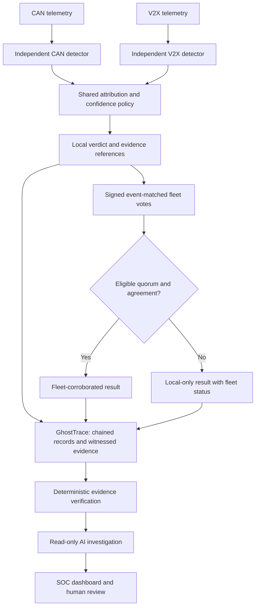

# CAPSTONE — VerdictTrace

**VerdictTrace- Tamper-Evident, Byzantine-Robust Cross-Layer Drift Attribution for Connected Vehicle Fleets**

PES University · CSE · Batch 51 · Guide: **Prof. Saravanaraj S**

VerdictTrace is a proposed detection, attribution and forensic-evidence system for connected vehicle fleets. It investigates whether independent CAN and V2X analysis, event-matched fleet corroboration and witnessed evidence can improve the distinction between benign changes and attacks.

**Status: Phase 1 / ESA proposal.** This repository contains the presentation, literature evidence and design plan. The detector, fleet protocol, GhostTrace service, AI investigator, dashboard and datasets have not yet been implemented or experimentally validated. Document-generation code is included; it is not a security-system prototype.

## Team and planned responsibilities

| Team member | SRN | Phase 1 project plan |
|---|---|---|
| Dhanush Sai Suprapadha | PES2UG24CS154 | CAN and V2X datasets, independent baselines and synchronized scenarios with Eshwar |
| Gurubelli Yekambar Eshwar Rao | PES2UG24CS173 | Joint dataset and baseline work with Dhanush, policy evaluation and quorum fallback |
| Shreya R D | PES2UG24CS680 | GhostTrace evidence verification |
| Amruta Karoshi | PES2UG24CS675 | Read-only AI investigator and analyst dashboard |

All four members share responsibility for integration, held-out experiments, bench measurements and manuscript preparation.

## Research library

Browse [all 97 catalog records](research/phase1-esa/master-catalog.md#all-97-records) for linked titles, publication details, relevance and evidence status. The catalog contains 96 literature records and one standalone dataset. For a paper cited in the presentation or report, use the [ESA reference numbers](research/phase1-esa/README.md).

## Start here

| Material | Contents |
|---|---|
| [Phase 1 ESA presentation](docs/phase1-esa/51_Phase1_ESA.pptx) | End-semester assessment |
| [ESA report](docs/phase1-esa/51_Phase_1_ESA%20REPORT.pdf) | Project report and numbered references |
| [Weekly report](docs/phase1-esa/51_Phase1_WeeklyReport_Signature.docx) | Phase 1 team record |
| [ESA literature index](research/phase1-esa/README.md) | 16 core studies, five supporting references and the broader search catalog |
| [Latest Review 1 presentation](docs/presentation/review1-2026-10-12/README.md) | 23 slides, updated 12 October 2026: editable Keynote, PowerPoint and PDF |
| [Earlier Review 1 presentation](docs/presentation/VerdictTrace_Phase1_Review1_Final.pptx) | Archived 12-slide proposal |
| [Research evidence guide](docs/research/VerdictTrace_Research_Gap_Evidence.pdf) | 13 papers, contextual summaries, highlighted short excerpts, gaps, proposed methods and source links |
| [Project proposal](docs/proposal.md) | Problem, scope, planned contributions and use cases |
| [Architecture](docs/architecture.md) | Independent detectors, shared attribution, fleet corroboration, GhostTrace and bounded AI |
| [CAN + V2X integration clarification](docs/can-v2x-integration.md) | Prior integration work and the difference between feature fusion and shared attribution |
| [Evaluation plan](docs/evaluation-plan.md) | Baselines, scenario labels, ablations and success measures |
| [Feasibility and roadmap](docs/feasibility-and-roadmap.md) | INR 20,000 planning ceiling, available hardware and staged milestones |
| [Literature index](research/README.md) | Original-paper links and evidence status, including one later comparison paper |
| [Earlier presentation text and notes](docs/presentation-notes.md) | Searchable snapshot of the archived 12-slide deck |

The ESA presentation follows the October Review 1 revision. Earlier presentation files and proposal documents remain available as historical material. The expanded research guide and integration clarification contain additional literature analysis. The 2026 dual-domain IDS reference appears in the latest presentation and is documented separately; it is not included in the 13-paper PDF.

## Proposed architecture



Cross-layer correlation modifies confidence; it does not independently establish an attack or clear a strong single-layer alert. The AI investigator is downstream of canonical verdicts and evidence verification. It has no authority to control a vehicle or rewrite those records.

## Planned evaluation

The team plans to compare CAN-only, V2X-only and synchronized CAN/V2X observations from the same event. Cause-labelled scenarios will track attribution errors and cases where the available evidence supports no verdict. In the simulated message-delivery test, receiver logs will show which warnings arrived, including genuine warnings incorrectly withheld.

GhostTrace experiments will vary evidence modification, connectivity loss and witness availability separately. Investigators will check whether available records match signed commitments and whether missing payloads can be recovered. The team will also assess whether AI summaries cite the records supporting each claim.

## Research positioning

CAN and V2X integration already appears in published work. VerdictTrace does not claim to be the first combined system. Its proposed research contribution must be established through cause-labelled experiments, explicit insufficient-quorum behaviour, evidence preservation under outages and an evaluated, isolated investigation agent.

## Rebuild the research PDF

The editable PowerPoint can be opened directly. To regenerate the research PDF from its structured content:

```bash
python3 -m venv .venv
source .venv/bin/activate
python -m pip install -r scripts/requirements.txt
python scripts/build_research_guide.py
```

The script overwrites the PDF under `docs/research/` and writes layout metadata under the ignored `build/` directory. Review the rendered PDF after changing content. The edition date is part of the document source.

## Reference materials and rights

[Original supplied files](references/README.md) are retained as background. They may contain earlier scope or terminology. Third-party research papers are linked rather than redistributed as full-text files. See [RIGHTS.md](RIGHTS.md).
